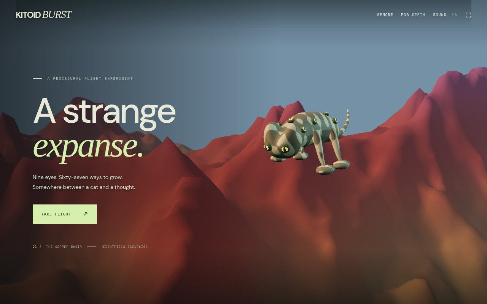

# Kitoid Burst

Grow a nine-eyed creature and fly through an endless copper-and-teal world.
Skim ridges to recharge, burst through gates, bank into turns, and find your own
line through the mountains. A 67-allele genome changes your creature's shape,
branches, eyes, and markings; keep parents, cross specimens, and explore the seed atlas.

**[Play in your browser](https://iskamag.com/games/kitoid-burst/)** ·
[Flight manual and technical guide](docs/game-guide.md)



## Play

A WebGL 2 browser with hardware acceleration is required. Keyboard, mouse,
touch, and standard gamepads are supported. Audio is synthesized in the browser.

| Input | Action |
| --- | --- |
| W / S, A / D or arrows | Pitch and turn |
| Shift | Burst |
| Space / X | Airbrake |
| Q / E or Z / C | Roll; double-tap to spin |
| Drag / wheel | Orbit / zoom the camera |
| V | Reset camera |
| N / R | Next route / retry |
| G | Genome editor |
| P / Escape / H | Pause and flight manual |

Four flight routes cross an unbounded landscape. Genomes and personal bests
stay in your browser; genomes can also be exported and imported as JSON.

## Run locally

Node.js 20.11 or later. No dependencies to install.

```sh
npm start
```

Open http://localhost:4173. `PORT` overrides the port. Rendering code, fonts,
and the starting terrain are bundled; the game makes no third-party requests.

## Static deployment

```sh
npm run build
```

Upload the contents of `dist/` to any static HTTPS host. Relative asset and
worker URLs support subdirectories, including `/games/kitoid-burst/`.
The build includes only runtime files and the current terrain bake.
`deploy/games-index.html` is the companion listing for `iskamag.com/games/`.

## Check

```sh
npm run check
npm test
npm run test:routes
```

Browser checks use Playwright and Chromium; see the [guide](docs/game-guide.md#validate)
for visual, input, streaming, and performance checks. Captures are not part of the release.

## Credits and license

Code: [MIT](LICENSE). Three.js is bundled with its [MIT license](vendor/THREE-LICENSE).
DM Sans and Space Mono retain their [SIL Open Font](vendor/DM-Sans-LICENSE)
[licenses](vendor/Space-Mono-LICENSE).

The flying-creature premise and several flight mechanics were inspired by
[Kitten Burst](https://jam2go.com/kitten-burst). Kitoid Burst is an independent project.
